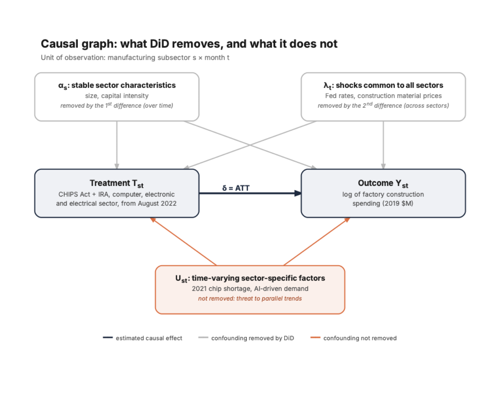

```{python}
#| include: false
import sys
import time
from datetime import date

sys.path.insert(0, "../src")

import plotly.io as pio
import polars as pl
from IPython.display import Image, Markdown, display

import data_processing as dp
import did
import synth
from plot_functions import (annual, plot_event_study, plot_gaps, plot_monthly, plot_placebos, plot_ranking,
                            plot_specs, plot_synth, set_theme)

set_theme()
W, SCALE = 900, 2
pio.renderers.default = "png"
pio.renderers["png"].width, pio.renderers["png"].scale = W, SCALE

def show(fig, height=400, top=50, width=W, font=15):
    """Static PNG of a plotly figure for the PDF. Kaleido sometimes runs its script before the page has loaded
    (ReferenceError: kaleido_scopes is not defined), so the export is retried."""
    fig.update_layout(title=None, width=width, height=height, font_size=font,
                      margin=dict(l=70, r=30, t=top, b=50))
    for attempt in range(100):
        try:
            png = fig.to_image(format="png", width=width, height=height, scale=SCALE)
            break
        except Exception:
            if attempt == 99:
                raise
            time.sleep(0.3)
    display(Image(png))

# --- Formatting --------------------------------------------------------------
def num(x, d=2, sign=False):
    return f"{x:{'+' if sign else ''}.{d}f}".replace("-", "−")

def pct(x):
    return f"{x:+.0%}".replace("-", "−")

def bn(x, md=False):
    """$ amount in billions; `md=True` escapes the $ for Markdown tables (inline output is not parsed)."""
    return f"{chr(92) if md else ''}${x:.1f}bn"

def mn(x):
    return f"${x:,.0f}M"

def q(d):
    return f"{d.year}-Q{(d.month - 1) // 3 + 1}"

def month(d):
    return f"{d:%B %Y}"

def md_table(header, rows, align):
    lines = ["| " + " | ".join(header) + " |", "|" + "|".join(align) + "|"]
    lines += ["| " + " | ".join(r) + " |" for r in rows]
    return Markdown("\n".join(lines))

# --- Data ----------------------------------------------------------------------
data = dp.load_processed()
census, fred, oecd, cim = (data[k] for k in ("census_construction_real_monthly", "fred_monthly",
                                             "oecd_gfcf_index2019_quarterly", "cim_totals_quarterly"))
PANEL = data["did_panel_monthly"]
MFG = PANEL.filter(pl.col("sector").str.starts_with("mfg_"))
SECTORS = dp.mfg_sectors(census)
CONTROLS = [c for c in SECTORS if c != dp.TREATED_SECTOR]
n_controls = len(CONTROLS)
n_donors = len([c for c in oecd.columns if c not in ("quarter", dp.TREATED_COUNTRY)])

mfg_year = annual(fred, "date", ["TLMFGCONS_real"]).filter(~pl.col("partial"))
real_2021 = mfg_year.filter(pl.col("year") == 2021)["TLMFGCONS_real"].item() / 1000
real_2024 = mfg_year.filter(pl.col("year") == 2024)["TLMFGCONS_real"].item() / 1000
cim_year = annual(cim, "quarter", ["announced", "actual"], how="sum")
cim_peak = cim_year.sort("announced", descending=True).row(0, named=True)

ctrl = census.with_columns(pl.mean_horizontal(CONTROLS).alias("controls"))
at = lambda d, c: ctrl.filter(pl.col("date") == d)[c].item()
tr_jun21, tr_jun22 = at(date(2021, 6, 1), dp.TREATED_SECTOR), at(date(2022, 6, 1), dp.TREATED_SECTOR)
tr_sep21, tr_oct21 = at(date(2021, 9, 1), dp.TREATED_SECTOR), at(date(2021, 10, 1), dp.TREATED_SECTOR)
ct_jun21, ct_jun22 = at(date(2021, 6, 1), "controls"), at(date(2022, 6, 1), "controls")

# --- DiD -----------------------------------------------------------------------
months_in = lambda a, b: MFG.filter(pl.col("date").is_between(a, b))["date"].n_unique()
n_before = months_in(*did.BEFORE)
n_transition = months_in(*did.TRANSITION)
n_after = months_in(*did.AFTER)
last_month = MFG["date"].max()

cm = did.cell_means(MFG)
delta_up = did.did_2x2(MFG)
tw = did.twfe(MFG)
rd = did.readings(MFG)
dl = did.dollars(MFG)
eff_up, eff_low = rd["effect"]
delta_low = rd["delta"][1]
bn_up, bn_low = dl["bn_per_year"]

es = did.event_study(MFG)
es_q = lambda s: es.filter(pl.col("quarter") == s)["coef"].item()
plateau = es.filter(pl.col("date").is_between(*did.BEFORE))["coef"]
dyn = {r["moment"]: r for r in did.dynamics(es).iter_rows(named=True)}

tp = did.time_placebos(MFG)
tp_max, tp_last = tp["delta"].max(), tp["date"].max()
tp_above = (tp["delta"] >= delta_up).sum()
perm = did.permutation(MFG).row(0, named=True)
n_sectors = MFG["sector"].n_unique()

rob_did = did.robustness(PANEL)
rob = dict(rob_did.iter_rows())
rob_ctrl = [rob["Without transportation equipment"], rob["Controls + offices and commercial"]]

# --- Synthetic control -------------------------------------------------------
w = synth.weights(oecd)
w_pos = w.filter(pl.col("weight") > 0.001)
wd = dict(w.iter_rows())
EUROPE = {"AUT", "CZE", "DEU", "DNK", "ESP", "FIN", "FRA", "GBR", "IRL", "ITA", "NLD", "NOR", "POL", "PRT", "SWE"}
w_europe = sum(v for c, v in wd.items() if c in EUROPE)
fit = data["oecd_donor_fit"].filter(pl.col("country") == "IRL").row(0, named=True)

s = synth.synthetic(oecd)
sm = synth.summary(s)
trough = s.filter(pl.col("quarter").is_between(date(2020, 1, 1), synth.PRE[1])).sort("gap").row(0, named=True)
last_q = s.tail(1).row(0, named=True)

gaps, ratios = synth.space_placebos(oecd)
pv = synth.p_values(ratios)
p_all, p_fit = pv["p"]
n_all, n_fit = pv["countries"]
usa_rank = pv["usa_rank"][0]
ahead = ratios.filter(pl.col("rank") < usa_rank)["country"].to_list()

rob_sc = synth.robustness(oecd, data["oecd_donor_fit"])
rsc = dict(rob_sc.iter_rows())
others = [v for k, v in rsc.items() if (k.startswith("Without") and k != "Without IRL") or "best" in k]

NAMES = {"IRL": "Ireland", "JPN": "Japan", "SWE": "Sweden", "CAN": "Canada", "FIN": "Finland", "AUS": "Australia",
         "ESP": "Spain", "CZE": "Czechia", "ITA": "Italy", "FRA": "France", "AUT": "Austria", "NLD": "the Netherlands"}
w_list = ", ".join(f"{NAMES[c]} ({v:.2f})" for c, v in w_pos.iter_rows())
ahead_list = ", ".join(NAMES.get(c, c) for c in ahead)
```

```{=typst}
#show figure.where(kind: "quarto-float-fig"): set figure(placement: auto)
#show figure.where(kind: "quarto-float-tbl"): set figure(placement: auto)
#show table: set par(justify: false)
#show table: set text(size: 9.5pt)
```

# Introduction

In August 2022 the United States passed two industrial policy laws within a week. The CHIPS and Science Act (9 August) funds the return of semiconductor production with about \$52bn of subsidies and tax credits. The Inflation Reduction Act, or IRA (16 August), grants large tax credits to clean energy and to its manufacturing supply chain: batteries, solar panels, electric vehicles and hydrogen. In the following two years, real spending on US factory construction rose from `{python} bn(real_2021)` in 2021 to `{python} bn(real_2024)` in 2024 (annual averages, 2019 dollars). Over the same period, however, firms were reshoring production after COVID, a global chip shortage was pushing chipmakers to expand, demand for AI chips exploded and the Federal Reserve raised its rates. A simple before and after comparison cannot separate these forces.

Our question is the following: **how much of the increase in factory construction spending in the computer, electronic and electrical sector since August 2022 was caused by the CHIPS Act and the IRA?** The treatment is the package formed by the two laws, which entered into force the same month and cannot be separated in the data. The outcome is real private spending on the construction of plants in that sector, the sector of semiconductor, electronics and battery plants. The population is US manufacturing, split into `{python} len(SECTORS)` subsectors, observed monthly from July 2019 to `{python} month(last_month)`. A second analysis widens the population to `{python} n_donors + 1` OECD countries to ask whether the effect is visible in the aggregate investment of the United States.

The results fit in three sentences. Compared with the other manufacturing subsectors, the laws raised factory construction in the treated sector by `{python} pct(eff_low)` to `{python} pct(eff_up)`, i.e. `{python} bn(bn_low)` to `{python} bn(bn_up)` per year in 2019 dollars; the range comes from a rise in late 2021, before the laws, that the data cannot attribute with certainty. The effect peaks in late 2023 and then declines as plants are completed. At the country level, US non-residential investment exceeds its synthetic twin by `{python} num(sm["mean_gap"], 1, True)` index points, but this gap does not stand out from placebo countries and almost vanishes without Ireland among the donors.

# Data

@tbl-data lists the sources. The main outcome comes from the Census Bureau series on the value of private construction put in place [@census_c30]. It measures spending actually incurred each month, not announced projects, at a seasonally adjusted annual rate. Since construction costs rose sharply in 2021 and 2022, nominal amounts are deflated by the construction materials price index from FRED [@fred], normalised to its 2019 average, and are expressed in 2019 dollars. The difference-in-differences works on the logarithm of this real spending, so that effects read as percentages.

For the country comparison, we use OECD quarterly national accounts on gross fixed capital formation in non-residential buildings and structures [@oecd_qna]. These series are already in volume, but in national currencies, so each country is rebased to 100 = 2019. The Clean Investment Monitor [@cim] is used only as context: announced investment in clean technology factories peaked in `{python} cim_peak["year"]` at `{python} bn(cim_peak["announced"])` (2024 dollars), the year of the IRA, and actual spending followed one to two years later.

```{python}
#| label: tbl-data
#| tbl-cap: "Data sources. All series are public and were downloaded on 26 October 2026."
span = lambda df, x, f: f"{f(df[x].min())} to {f(df[x].max())}"
ym = lambda d: f"{d:%Y-%m}"
md_table(
    ["Source", "Series", "Frequency", "Coverage", "Role"],
    [["Census Bureau", f"Private construction spending: {len(SECTORS)} manufacturing subsectors, offices, commercial",
      "Monthly", span(census, "date", ym), "DiD outcome"],
     ["FRED", "Construction materials price index (WPUSI012011)", "Monthly", span(fred, "date", ym), "Deflator"],
     ["OECD", f"Investment in non-residential structures, volume, {n_donors + 1} countries", "Quarterly",
      span(oecd, "quarter", q), "Synthetic control outcome"],
     ["Clean Investment Monitor", "Clean technology factories, announced and actual investment", "Quarterly",
      span(cim, "quarter", q), "Context"]],
    [":-------------", ":----------------------------------", ":-----------", ":--------------------", ":----------------"])
```

# Identification strategy

## Causal graph and estimand

The difference-in-differences (DiD) compares the change in spending in the treated sector with the change in the other manufacturing subsectors, called the control sectors, before and after August 2022. @fig-dag shows what this double comparison removes. Stable differences between sectors ($\alpha_s$, such as size or capital intensity) disappear when each sector is compared with itself over time. Shocks common to all sectors ($\lambda_t$, such as interest rates or materials prices) disappear when the treated sector is compared with the control sectors. What remains is a factor that evolves differently across sectors ($U_{st}$), such as the 2021 chip shortage or AI-driven demand: it affects both the timing of the treatment, since the laws target this sector precisely because chips became strategic, and the outcome. This is the main threat to the design.

{#fig-dag width=62%}

The estimand is the average treatment effect on the treated (ATT): the average difference, from August 2022 onwards, between the log spending observed in the treated sector and the log spending it would have recorded without the laws. We call this difference $\delta$ and report it as a percentage, $e^{\delta} - 1$. The synthetic control estimates the same kind of quantity for the United States as a whole, in index points.

## Assumptions and their credibility

Three assumptions are needed. Consistency requires a well-defined treatment: here it is the package of the two laws, and we do not try to separate them. No anticipation requires that nothing reacts before August 2022. This is doubtful, since the CHIPS Act was debated in Congress from 2021 and large chipmakers announced US plants before the vote. Parallel trends, the key assumption, states that without the laws the treated sector would have evolved like the control sectors, in percentage terms. It cannot be tested after 2022, but it can be checked before: if the two groups moved together for several years, the assumption is more plausible. @sec-event shows that this holds from mid-2019 to mid-2021, but not over a longer window. Finally, the control sectors must not be affected by the laws themselves. This is mostly true, with one exception: transportation equipment includes electric vehicle plants, which benefit from the IRA.

## Choice of control group and of a second design

Our `{python} n_controls` control sectors (chemicals, food and beverages, plastics, non-metallic minerals, fabricated metals and transportation equipment) come from the same survey, face the same interest rates, labour market and materials prices, and are not the direct target of the laws. Offices and commercial buildings serve as alternative controls in the sensitivity analysis. With a single treatment date, the regression with sector and month fixed effects is exactly the simple comparison of means, so the problems of DiD with staggered treatment timing [@goodmanbacon2021] do not arise.

The DiD fails if the treated sector was hit by its own shock at the same time as the laws. The chip shortage and the AI boom are such shocks, but they were global. This motivates a second design, the synthetic control [@abadie2010; @abadie2021], which compares the United States with a weighted average of other OECD countries exposed to the same global shocks but not to the US laws. Its own weaknesses are different: its outcome covers all non-residential structures, so the effect is diluted, and the comparison countries may have been affected by the laws through relocated projects, or by their own shocks such as the European energy crisis. The two designs therefore fail for different reasons, and agreement between them would be more convincing than either alone.

# Difference-in-differences

## The raw comparison

@fig-monthly plots monthly real spending in the treated sector and the average of the control sectors. The rise starts before the laws. Treated-sector spending goes from `{python} mn(tr_jun21)` in June 2021 to `{python} mn(tr_jun22)` in June 2022, with a jump between September and October 2021 (from `{python} mn(tr_sep21)` to `{python} mn(tr_oct21)`), while the control average barely moves (from `{python} mn(ct_jun21)` to `{python} mn(ct_jun22)`). This rise can reflect anticipation of the laws or the chip shortage. The data cannot tell which.

```{python}
#| label: fig-monthly
#| fig-cap: "Monthly construction spending, treated sector and average of the control sectors, 2019 \\$M at an annual rate. The dotted line marks August 2022."
show(plot_monthly(ctrl, "date", [dp.TREATED_SECTOR, "controls"], date(2020, 1, 1), date(2023, 12, 1),
                  highlight=dp.TREATED_SECTOR, ytitle="2019 $M (annual rate)"), height=360)
```

## Event study and choice of the before window {#sec-event}

An event study computes, quarter by quarter, the gap in log spending between the treated sector and the control sectors, relative to its average over a reference period. If parallel trends held before the laws, the points before 2022 should stay close to zero. @fig-event shows three phases. From 2015 to 2019, the treated sector catches up with the control sectors (`{python} num(es_q("2017-Q1"))` in 2017-Q1), so a long before window would violate parallel trends. From mid-2019 to mid-2021, the gap stays between `{python} num(plateau.min())` and `{python} num(plateau.max(), sign=True)`. From 2021-Q4 it rises (`{python} num(es_q("2021-Q4"), sign=True)`), before the laws.

```{python}
#| label: fig-event
#| fig-cap: "Event study: log gap between the treated sector and the control sectors by quarter, relative to its mean from July 2019 to June 2021 (light band). The darker band is the transition period excluded from the estimation."
show(plot_event_study(es, did.BEFORE, did.TRANSITION), height=380, top=60)
```

We therefore use this plateau as the before period (`{python} n_before` months, July 2019 to June 2021) and exclude the `{python} n_transition` transition months up to July 2022. This window was chosen after looking at the data, which carries a risk of choosing a favourable reference; @sec-sensitivity reports the result with the full window from 2015.

## Estimates

Between the before period and the after period (`{python} n_after` months, August 2022 to `{python} month(last_month)`), log spending rises by `{python} num(cm["change"][0], 3)` in the treated sector and by `{python} num(cm["change"][1], 3)` in the control sectors, hence $\delta$ = `{python} num(delta_up, 3)`. The regression with sector and month fixed effects gives the same value.

The rise of late 2021 leads to two readings, shown in @tbl-bounds. The upper bound assumes that, without the laws, the sector would have stayed at its 2019 to 2021 level, so that all of the late-2021 rise is anticipation of the laws. The lower bound assumes that this rise, linked to the chip shortage, would have happened anyway, and uses the transition months as the reference. The truth probably lies in between. In dollars, the effect is the observed spending minus the spending predicted without the laws, $Y/e^{\delta}$; the two bounds are closer in dollars than in percent because they start from the same observed spending.

```{python}
#| label: tbl-bounds
#| tbl-cap: "Range of the DiD effect, average since August 2022. Effect in % is $e^{\\delta} - 1$; dollars are 2019 \\$bn per year."
labels = {"Upper bound: anticipation": "Upper bound (anticipation)", "Lower bound: chip shortage": "Lower bound (chip shortage)"}
md_table(["Reading", "Reference window", "$\\delta$ (log)", "Effect", "\\$bn per year"],
         [[labels[r["reading"]], r["before"].replace("→", "to"), num(r["delta"], 3), pct(r["effect"]), bn(d, md=True)]
          for r, d in zip(rd.iter_rows(named=True), dl["bn_per_year"])],
         [":------------------------", ":--------------------", "------------:", "-----------:", "--------------:"])
```

The effect is not constant. Measured against the plateau, it reaches `{python} pct(dyn["First quarter"]["effect"])` in `{python} dyn["First quarter"]["quarter"]`, peaks at `{python} pct(dyn["Peak"]["effect"])` in `{python} dyn["Peak"]["quarter"]`, then falls back to `{python} pct(dyn["Last quarter"]["effect"])` in `{python} dyn["Last quarter"]["quarter"]`. Since the outcome is a flow of construction spending, this decline is expected: once plants are built, spending stops. It does not mean that the plants disappear. These dynamics use the plateau as reference and are therefore upper-bound figures.

## Inference

With a single treated sector, the usual standard error clustered by sector (`{python} num(tw["se_cluster"], 3)`) is not reliable, so uncertainty is assessed with placebos: the same estimate computed where no effect should exist. In-time placebos apply the same DiD, with the same window lengths, to `{python} tp.height` fake treatment dates between `{python} month(tp["date"].min())` and `{python} month(tp_last)`, before the 2021 rise. The largest of them is `{python} num(tp_max)`, and `{python} "none" if tp_above == 0 else tp_above` of them reach the true $\delta$ (@fig-time-placebos in the appendix). The true $\delta$ exceeds it by `{python} num(delta_up - tp_max)` with the upper bound and by `{python} num(delta_low - tp_max)` with the lower bound. Because consecutive fake dates share most of their months, they are not independent draws, and the count is not a p-value; it shows that a gap of this size never occurred in the sector's recent history. The permutation test assigns the treatment to each of the `{python} n_sectors` sectors in turn. The treated sector has the only positive $\delta$ (placebos from `{python} num(perm["placebo_min"], 3)` to `{python} num(perm["placebo_max"], 3)`), which gives p = `{python} num(perm["p"], 3)`, i.e. 1/`{python} n_sectors`, the smallest value possible with `{python} n_sectors` sectors. A conventional 5% threshold is out of reach by construction.

```{=typst}
#place.flush()
```

# Synthetic control

## Donor weights and fit

The synthetic twin of the United States is a weighted average of the `{python} n_donors` other OECD countries, called donors, with non-negative weights summing to one, chosen to track the US index as closely as possible from 2015-Q1 to 2022-Q2. The weights select `{python} len(w_pos)` donors: `{python} w_list` (@fig-weights in the appendix). European countries account for `{python} f"{w_europe:.0%}"` of the weight.

@fig-synth compares the United States with its twin. The fit is good until 2019, then weaker: the root mean squared prediction error (RMSPE) before treatment is `{python} num(sm["rmspe_pre"])` index points, and the United States falls `{python} num(abs(trough["gap"]), 1)` points below its twin in `{python} q(trough["quarter"])`. After 2022-Q3, the United States exceeds its twin by `{python} num(sm["mean_gap"], 1, True)` points on average, with a peak of `{python} num(sm["peak_gap"], 1, True)` in `{python} sm["peak_quarter"]` and `{python} num(last_q["gap"], 1, True)` in `{python} q(last_q["quarter"])`. Part of this gap may simply be a rebound from the 2021 trough.

```{python}
#| label: fig-synth
#| fig-cap: "Investment in non-residential buildings and structures, United States and synthetic twin, volume index 100 = 2019. The weights are fitted on 2015-Q1 to 2022-Q2."
show(plot_synth(s), height=340)
```

## Inference with placebos in space

Placebos in space treat each donor country in turn as if it had passed the laws, build its own twin from the other donors, and compare the post-treatment divergence with its pre-treatment fit (the ratio of post to pre RMSPE). @fig-placebos shows that several countries diverge from their twin as much as the United States after 2022. The United States ranks `{python} usa_rank`th out of `{python} n_all`, behind `{python} ahead_list`, which gives a rank p-value of `{python} num(p_all, 3)` (the minimum would be 1/`{python} n_all`). Keeping only the `{python} n_fit` countries whose pre-treatment fit is at most twice as poor as that of the United States raises it to `{python} num(p_fit, 3)`. The US gap does not stand out.

```{python}
#| label: fig-placebos
#| fig-cap: "Gap between each country and its synthetic twin, in index points. Orange: United States. Grey: the other countries treated as placebos."
show(plot_gaps(gaps), height=320)
```

## Dependence on Ireland

Ireland carries the largest weight (`{python} num(wd["IRL"])`) although its series is very volatile: its correlation with the United States before 2022 is the highest of all donors (`{python} num(fit["corr_pre"])`), but its mean squared deviation is large (`{python} num(fit["rmse_pre"])` points). Removing Ireland from the donors reduces the mean gap from `{python} num(sm["mean_gap"], 1, True)` to `{python} num(rsc["Without IRL"], 1, True)` points, while removing any other donor leaves it between `{python} num(min(others), 1, True)` and `{python} num(max(others), 1, True)`. The country-level result rests on a single donor.

# Sensitivity analysis and limitations {#sec-sensitivity}

@fig-robust summarises the sensitivity of both designs. In the DiD, excluding transportation equipment from the controls or adding offices and commercial buildings keeps the effect between `{python} pct(min(rob_ctrl))` and `{python} pct(max(rob_ctrl))`. Measuring the outcome in levels gives `{python} pct(rob["Outcome in levels"])`, but assumes that the treated sector would have gained as many dollars as the control sectors, rather than the same percentage. The before window starting in 2015 gives `{python} pct(rob["Before window 2015-01 → 2022-07"])`, because it mixes the 2017 to 2019 catch-up with the effect: the result depends strongly on the reference period. In the synthetic control, a fake treatment in 2019-Q1 gives `{python} num(rsc["In-time placebo (2019-Q1)"], 1, True)` points and moving the treatment to 2021-Q3 gives `{python} num(rsc["Treatment moved to 2021-Q3"], 1, True)`; Ireland remains the decisive donor.

@tbl-threats lists the remaining threats and the direction in which each would bias the estimates.

| Threat | Why it matters | Likely bias |
|:----------------------|:-----------------------------------------------|:------------------------------|
| Anticipation | Plants announced while the CHIPS Act was debated in 2021 raise spending before August 2022. | Lower bound too low; covered by the range. |
| Chip shortage (selection on trends) | The laws target the sector that was already expanding because of a sector-specific shock. | Upper bound too high. |
| AI boom | Demand for AI chips raises fab construction from 2023, independently of the laws. | DiD overestimated. |
| Spillover to transportation equipment | Electric vehicle plants in this control sector also receive IRA credits. | DiD underestimated (small: removing it changes little). |
| Spillover to Europe | Projects attracted to the United States would otherwise have been built in donor countries. | Twin too low, synthetic control overestimated. |
| European energy crisis | Most of the twin's weight is European, and Europe slowed down in 2022-2023. | Synthetic control overestimated. |
| Outcome too broad for the synthetic control | Offices and infrastructure weigh much more than the plants targeted by the laws. | Synthetic control effect diluted, underestimated. |
| A single treated sector | Inference rests on a handful of sectors and on placebos, not on sampling uncertainty. | No direction; limits the precision of any claim. |

: Main threats to identification and direction of the bias. {#tbl-threats}

```{python}
#| label: fig-robust
#| fig-cap: "Sensitivity of the two designs. Orange bars are the main specifications."
#| fig-subcap:
#|   - "DiD: average effect since August 2022, $e^{\\delta} - 1$."
#|   - "Synthetic control: mean gap after 2022-Q3, index points."
#| layout-ncol: 2
spec_short = {"Main (transition excluded)": "Main", "Without transportation equipment": "Without transport. equip.",
              "Controls + offices and commercial": "+ offices, commercial", "Outcome in levels": "Outcome in levels",
              "Before window 2015-01 → 2022-07": "Before window from 2015"}
show(plot_specs(rob_did.with_columns(pl.col("specification").replace(spec_short)), "specification", "effect", "Main"),
     height=460, top=20, width=640, font=19)
sc_short = {"Main (2022-Q3)": "Main", "Treatment moved to 2021-Q3": "Treatment in 2021-Q3",
            "In-time placebo (2019-Q1)": "Placebo in 2019-Q1", "5 best-correlated donors": "5 best donors"}
show(plot_specs(rob_sc.with_columns(pl.col("specification").replace(sc_short)), "specification", "mean_gap", "Main",
                pct=False), height=460, top=20, width=640, font=19)
```

```{=typst}
#place.flush()
```

# Conclusion

What can be claimed is that factory construction in the computer, electronic and electrical sector rose far more after August 2022 than in any other manufacturing subsector, by `{python} pct(eff_low)` to `{python} pct(eff_up)`, i.e. `{python} bn(bn_low)` to `{python} bn(bn_up)` per year in 2019 dollars. No comparable gap appears at any earlier date or in any other sector. The size of the effect, rather than a formal test, is the main evidence.

What cannot be claimed is that all of this increase is due to the laws. The DiD cannot separate the laws from the chip shortage, which started before them, or from the AI boom, which followed them. At the country level the effect is not distinguishable from the variation seen in other countries, and it depends on a single donor. A broad national aggregate is however a weak test of a policy aimed at one type of plant.

Going further would require finer data. A state-level or plant-level panel, such as the Clean Investment Monitor's project database, would allow comparing places more or less exposed to the credits, and sectors targeted by the IRA alone (batteries, solar) would offer additional treated units. The partial rollback of some credits from 2025 also provides a second event to test whether investment responds to the policy in the opposite direction.



# References {.unnumbered}

::: {#refs}
:::

# Appendix {.unnumbered}

## Reproducibility {.unnumbered}

All figures and numbers in this report are computed when the document is rendered, from the functions in `src/` and the files in `data/processed/`.

```bash
uv sync --group dev
uv run python src/data_processing.py
uv run quarto render reports/rapport.qmd --to typst
```

## Additional figures {.unnumbered}

```{=typst}
#show figure.where(kind: "quarto-float-fig"): set figure(placement: none)
```

```{python}
#| label: fig-weights
#| fig-cap: "Donor weights in the synthetic twin, fitted on 2015-Q1 to 2022-Q2 (non-zero weights only)."
show(plot_ranking(w_pos, "country", "weight", n=w_pos.height, xtitle="Weight"), height=330, top=20)
```

```{python}
#| label: fig-time-placebos
#| fig-cap: "In-time placebos: the same DiD, with the same window lengths, estimated at fake treatment dates, against the true $\\delta$ (orange line)."
show(plot_placebos(tp, delta_up), height=360)
```
